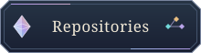
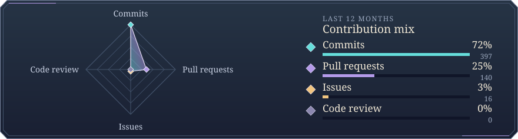

<!-- Built by scripts/build.mjs. Edit the generator, then rebuild. -->
<picture>
  <source media="(prefers-reduced-motion: reduce)" srcset="assets/scene.png">
  
</picture>

  

<!-- Introduction — Tristan will write this. -->

## Latest projects

<!-- latest:start -->

<!-- latest:end -->

## Featured projects

<table>
<tr>
<td width="38%" valign="top"> <code>Python</code> <code>FastAPI</code> <code>PostgreSQL</code> <code>Claude tool calling</code> <code>GitHub Actions</code></td>
<td valign="top">A resume-matching agent with a FastAPI web app. A scheduled Python job gathers internship postings, uses tool calling to retrieve details and explain matches, and sends an email digest. PostgreSQL stores the postings and results so the app can show them later.  <a href="https://github.com/trism-prism/internship-scout-agent">View repository →</a></td>
</tr>
<tr>
<td width="38%" valign="top"> <code>Python</code> <code>Streamlit</code> <code>PostgreSQL</code> <code>Docker</code> <code>GDELT</code></td>
<td valign="top">A situational awareness dashboard backed by a Dockerized ingestion worker. It reads the GDELT event feed, stores geolocated conflict and unrest reports in PostgreSQL, and detects unusual changes in activity by country. A Streamlit interface makes the events easier to explore on a map.  <a href="https://github.com/trism-prism/tripwire-awareness-dashboard">View repository →</a></td>
</tr>
<tr>
<td width="38%" valign="top"> <code>TypeScript</code> <code>Next.js</code> <code>React</code> <code>PostgreSQL / pgvector</code> <code>Local embeddings</code> <code>Claude</code></td>
<td valign="top">A retrieval-augmented generation (RAG) application for asking questions about PDFs. Local embeddings and pgvector find relevant passages, and the app generates answers with page-level citations. An evaluation view shows how it handles test questions and where it falls short.  <a href="https://github.com/trism-prism/docs-qa-copilot">View repository →</a></td>
</tr>
</table>

## Activity

<!-- activity:start -->

<!-- activity:end -->
